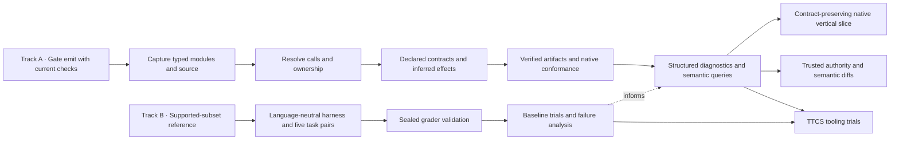

# Prioritized engineering plan

Implementation kickoff for typed backend and control-plane applications. The [audit baseline](repository-assessment.md) records pre-kickoff evidence, and the [architecture decision](../decisions/2026-11-26-analyzed-program-and-verification.md) records the selected direction and language decisions still under review.

## Implementation dependency map

Track B starts with the [supported subset](supported-subset.md) and [harness design](ttcs-harness.md) while Track A advances compiler correctness. Scope the conventional baseline by native builds and independent tests. It can run before the policy and query milestones. Both tracks converge on a native inventory change that an agent inspects, edits, repairs, verifies, compares for public signature and declared authority, then builds and tests. The support demo depends on additional runtime policy and review evidence.

## Stages, dependencies and acceptance

| Stage | Work and dependencies | Acceptance evidence |
| --- | --- | --- |
| 0. Evidence and contract inventory | Record the revision, suite and benchmarks. Classify documentation claims and unsupported language forms. Define the initial entry-closure and trust scope. Prototype the benchmark protocol using existing commands. | Reproducible baseline, source-linked discrepancy list and explicit list of analyzed call forms and policy sinks. Identify examples suited to analysis, native build, or illustrative use. |
| 1. Canonical program identity | Capture source bytes and retain typed modules, file ownership, symbol bindings and source and analysis identities. | Cross-file fixtures distinguish duplicate names by owner, exercise aliases and imports, reject ambiguity, and produce stable identities independent of checkout directory. Changes to source or trust inputs change the relevant identity. |
| 2. Sound call resolution | Resolve supported calls once for typing, graph construction and Go lowering. Pin the executable subset. Unsupported call forms produce explicit incomplete evidence or a defined rejection. | Qualified, direct, aliased, shadowed and unresolved calls exercise the normal CLI. Tests check that graph targets and native lowering agree, including cross-module containment and redline cases. |
| 3. Effect conformance | Resolve vocabulary and refinements, enforce declared caller–callee compatibility, and infer conservative effects from modeled operations and resolved targets. | Tests separately reject an unknown label, a caller missing a callee's unused grant and a body exceeding its own grant. Recursive and external-boundary cases exercise propagation, witnesses and coverage. |
| 4. Verified artifact boundary | Route `check`, `emit`, `build` and tool export through shared analysis and verification. Restrict artifact production to an encapsulated `VerifiedProgram`. Bind the artifacts to their analysis and build inputs. | Passing, rejected and indeterminate cases exercise each command. Source changes after capture cannot change verified lowering. Native integration observes approval denial without the gated side effect. |
| 5. Structured feedback | Add producer-owned codes, source ranges, causal links and per-property coverage in a versioned result. Preserve useful text output. | CLI conformance tests compare text and JSON meaning, check deterministic output, distinguish input failures and verify that proposed authority expansions require review. Track real CLI p50/p95. |
| 6. Semantic inspection | Expose a contract query and bounded module context before deeper path and impact queries. Use the verifier's canonical facts. | Cross-file fixtures exercise matching source and analysis identities, stable names, witnesses and explicit unresolved fields. An agent maintenance repair can be traced to the evidence inspected. |
| 7. TTCS experiments | Start harness and five-pair conventional pilot preparation in Stage 0. Run the pilot once fixture build and grading work. After structured feedback and inspection, evaluate same-Splash tooling and then augmented Go. | Reproducible fresh workspaces, sealed grading, immutable snapshots, observed milestone timing, cost accounting, repeated trials and paired uncertainty. Use outcomes, including negative results, to decide whether to scale. |
| 8. Authority and semantic diffs | Compare complete, compatible evidence from protected reanalysis or authenticated snapshots. Add machine-readable preservation contracts and a protected review workflow. | Tests cover expansions, removals, mixed changes, incomplete evidence and untrusted or mismatched snapshots. CI blocks unreviewed changes using a verifier and policy outside the patch's write access. |

Use the [semantic compiler interface](semantic-compiler-interface.md) as the architecture reference for these milestones. Executable conformance is part of each stage. Close the existing `emit` gap as soon as the shared path can enforce current checks, even if the stronger typed boundary lands later. The conventional pilot can proceed before the policy milestones. Use later TTCS results to prioritize language or ecosystem refinements and to decide whether startup, serialization or analysis cost warrants additional infrastructure.

## First implementation slices

1. Gate `emit` with the current checks. Capture a source closure and retain module-owned typed results through the shared command path. Exercise both with cross-file fixtures. Preserve current spelling and emitted behavior for accepted programs.
2. Carry resolved direct and qualified calls into the graph and Go emitter. Add conformance cases for name collisions, imported policies and unresolved targets. Use the existing command outputs to inspect the result before promising a public schema.
3. Add normalized effect validation and the two effect checks. Unify verified output behind the typed transition as each required property becomes enforceable. Start with supported call forms and a small effect vocabulary with explicit boundary summaries.

The initial brief should record the supported call forms, effect vocabulary and refinement rules, and the compatibility treatment for flat versus qualified imports. Those decisions constrain the first slices. The larger approval runtime, package resolver, persistent compiler and broad standard library remain separate investments.

The kickoff implements slice 1 and prepares the Track B reference and harness design. Slice 2 is the next bounded compiler change. Begin with direct and qualified named calls from the existing executable subset, carry the type checker's resolved declaration to graph construction and lowering, and cover ambiguous and shadowed names with independent tests. Review compatibility before making an unresolved form a new language error.

## Risks and decisions

- **Incomplete graph produces misplaced confidence.** Share binding/resolution facts across analyses and lowering. Make unsupported shapes and trust markers visible and test that completeness gates fail closed.
- **Cross-file compatibility breaks when binding becomes precise.** Inventory flat and qualified uses, preserve compatible source where unambiguous, and propose a migration with before/after examples for conflicts. Decide which module forms become canonical using real fixtures.
- **Checking and Go execution disagree.** Add native outcome and evaluation-order tests for the supported subset. Document native backend limitations and fail unsupported constructs explicitly. Keep test fixtures independent of the current verifier’s blind spots.
- **Tooling work outruns evidence.** Start with JSON CLI and one query. Compare the actual use of diagnostics and summaries before funding incremental caches, daemon, LSP or MCP. Record per-phase timing on multi-file programs with several roots.
- **Security policy changes are treated as ordinary repair.** Compare the same rules over base/head, require a protected approval path, and keep trust claims scoped to modeled boundaries.
- **Adapter scope grows too fast.** Target a reproducible fixture runner, fake data, a fake approval adapter and one explicit IO boundary. Defer production authentication, distributed storage, package grants and runtime orchestration until a demonstrated workload requires them.
- **The benchmark optimizes for a headline.** Publish eligibility, matched oracles and uncertainty. Use Go as a strong baseline and keep ordinary tasks prominent. Set a smallest meaningful improvement and guardrails before held-out trials.

## Reference demonstration 1: customer support

**Smallest credible version.** A backend workflow with synthetic customers and orders, one public customer/order tool projection, a refund recommendation, and a refund action backed by a fake ledger. No provider credentials or payment system are needed. Use a scripted fake provider and trusted registry seam for runtime calls once that seam exists. Explicitly model the adapter’s permitted effects. Approvals should bind to the request identity and exact approved operation in the runtime demonstration. Keep operator-only ledger administration redlined. Independently test that an unregistered tool cannot dispatch.

1. Give the coding agent a ticket to add refund eligibility validation. It inspects the function/adapter contracts and callers, writes a patch, responds to a structured diagnostic, and runs native fixture and hidden tests. Log elapsed time, input/output tokens, evidence read, first-pass status and repairs.
2. Run customer lookup and order history through the intended tools. Verify the input schemas and exact tool membership, and independently check the public fields in returned payloads. Show approve/deny outcomes on the fake ledger. Independently test unchanged state after denial and the redline verdict on covered calls. Identify which runtime boundary enforces dispatch and customer identity.
3. Give a second ticket to streamline recommendations. Include a candidate revision that unintentionally makes a valid, approval-gated write reachable from a previously read-only entry under a sufficiently broad outer policy, so static validity alone does not imply reviewer authorization. The diff must surface the new effect, root and witness. CI requires protected approval before release. Also include a distinct case rejected outright by the declared sandbox or redline.

Today the repo can demonstrate direct redline examples, schema export and generated approval code. The full demonstration depends on resolved policy scope, runtime registry and faithful lowering, deterministic fixtures, independent behavior tests, and authority snapshots. Limit classification claims to the tested projection and sink coverage.

## Reference demonstration 2: inventory reconciliation

Build a conventional inventory reconciliation service. Given a batch of shipments and existing stock, compute accepted/rejected lines, apply updates idempotently, and emit a reconciliation summary. Start with typed records, importable pure functions and a local fixture runner. Add HTTP/JSON and a repository adapter only after their contracts and failures are testable. The resulting program contains no AI runtime or agent entry.

Give the coding agent a follow-up requirement to support backorders or reconcile partial failures without double-applying stock. Have it inspect signatures and callers, implement the change, respond to real compiler feedback, and pass independent boundary, regression and property tests. Assess the public API/behavior diff, side effects and build artifact. Give an equivalent task to the same agent in idiomatic Go. Record the same TTCS metrics. The next iteration can compare human output with structured diagnostics on Splash itself.

## Milestone decisions

Proceed with structured feedback if the compiler can report and test a precise scope. Proceed with policy-bearing release tooling only after the relevant verification and lowering acceptance cases pass. Proceed with broad syntax or ecosystem work when the benchmark isolates a meaningful barrier in the chosen workloads. Keep general-purpose positioning contingent on a wider executable subset and comparable data.
