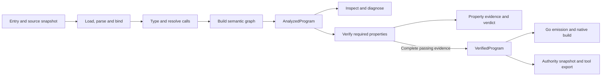

# Semantic compiler interface

Central compiler architecture proposal. Splash's language defines types, contracts and effects. The semantic compiler resolves those facts and exposes them to humans and agents. The trust architecture governs which verified facts can authorize artifact production and release. The [repository assessment](repository-assessment.md) describes the current implementation. This proposal extends the [April analyzed-program design](../superpowers/specs/2026-04-07-splash-language-positioning.md#L294).

The [kickoff decision](../decisions/2026-11-26-analyzed-program-and-verification.md) adopts this direction. The implemented compiler retains captured source and typed modules, resolves named calls, and requires an in-process `VerifiedProgram` after checking required source policies. Go emission, tool export, and VM lowering consume this handle. The `check` command now has a [versioned JSON report](#check-json-v1). Identities stable across revisions and persisted artifact provenance remain proposed. [Verification implementation](../../internal/compiler/verification.go)

## The analyzed program

The analyzed program is the compiler's canonical semantic representation. A shared entry point takes an explicit entry file, source reader and compilation configuration. It owns the source closure and retains typed modules, symbol bindings, call resolutions, provenance and policy evidence in an immutable snapshot. The parser, type checker, safety passes and backend keep distinct responsibilities and share those facts. Verification, tool export and lowering depend on this representation. Agent tooling consumes versioned projections of it. The public contract is the meaning of those projections and their coverage. Internal Go types can evolve independently.



Start with a small Go representation and indexes over existing compiler data. Keep pointer-keyed expression typing inside a snapshot. Make call resolutions and per-module ownership available to graph construction, effects, approval propagation and lowering. Flatten only at Go lowering, with deterministic, collision-safe emitted names.

Resolved edges carry caller and callee IDs, a call-site range, resolution kind, and a completeness state. Dynamic/indirect calls may require multiple candidate targets or an explicit unsupported or trusted boundary. Preserve reverse indexes and use stable ordering for witness selection. Record the policy rules applied and provenance for derived edges and annotations. A missing edge is unknown when analysis cannot account for the call site. An empty complete result has explicit coverage for its query scope.

Identify top-level symbols with a canonical module locator, declaration kind and declared name in the current snapshot. Use package identity and module-relative path today, with a future distinct dependency identity when a resolver exists. Import aliases, checkout paths, line numbers, display strings and generated Go names are unsuitable identity. Preserve locations separately. Detect ambiguous or duplicate declarations during binding. A rename normally appears as remove/add across revisions. A user-supplied rename map can help review and requires separate validation for policy decisions.

## Verified artifact production

Make verification a typed transition. `AnalyzedProgram` can retain incomplete facts for inspection. `VerifiedProgram` encapsulates the immutable analyzed snapshot and the passing evidence required by the verifier's artifact ruleset. Go emission, native build, verified tool export and verified authority snapshots consume this stronger type. The same verification path supplies `check` and the artifact commands. Model requirements by artifact purpose where they differ, and validate that the verified value covers the requested purpose.

```go
func Analyze(input SourceSnapshot, config Config) (*AnalyzedProgram, error)
func Verify(program *AnalyzedProgram) (*VerifiedProgram, VerificationReport, error)
func Emit(program *VerifiedProgram) ([]byte, error)
func Build(program *VerifiedProgram, config NativeBuildConfig) (NativeArtifact, error)
func ExportTools(program *VerifiedProgram) (*ToolManifest, error)
```

These signatures illustrate the broader design. The current `Verify` returns a report and a typed error for a rejection or indeterminate result, with no verified value. Keep the verified state private and construct it only inside the verifier. Because Go callers can still pass nil or create a zero value of an exported struct, centralize rejection of invalid handles in the artifact implementation and keep raw lowering private. Expose read-only projections or copies, never mutable maps, slices or AST pointers. Changing the source snapshot or any trust input requires fresh analysis and verification. A serialized report cannot construct a verified value.

Conformance tests should exercise these entry points and every artifact CLI command with passing, rejected and indeterminate fixtures. Include a test that changes source on disk between verification and emission. The artifact must come from the captured snapshot, or the operation must fail if its declared build inputs cannot be supplied. Native build and runtime test outcomes are separate from the static verifier's verdict.

## Declared authority and inferred effects

Proposed refinement of the documented caller–callee subset rule. Keep `needs` as an explicit declaration of permitted effects. Infer a conservative set of effects a function may exercise from its checked operations, resolved callees and trusted external summaries. For each function, require inferred effects to be a subset of declared authority. A diagnostic should identify the responsible operation or call site and a witness to the originating effect. Recompute summaries across recursive call groups to a fixed point. Unknown calls or unmodeled boundaries propagate uncertainty to the affected callers and roots. An empty complete set and an unknown set have different meanings.

Enforce both invariants in the initial design.

| Invariant | Check |
| --- | --- |
| Implementation conformance | `Inferred(f) ⊆ Declared(f)` for each function. |
| Call contract compatibility | `Declared(callee) ⊆ Declared(caller)` for every resolved target of a call. |

The second rule lets callers reason from a callee's contract even if a later conforming implementation starts exercising a previously unused grant. Inferred effects describe what the captured implementation may exercise. They support review of the exact build and identification of unused grants. Give the two failures distinct diagnostic codes and identify whether the witness leads to a grant or an operation. Reject unknown effect labels before computing either set. Independently replaceable boundaries need conservative reviewed declarations and defined revalidation rules. Keep inferred-only call checking as research for closed builds. It would require caller reanalysis when a substituted implementation expands its inferred set within its declared contract.

Show declared grants, inferred effects and coverage separately. With complete evidence, declared authority unused by the modeled implementation is a least-privilege review candidate. A narrower public grant can affect clients or future substitutions, so narrowing remains an explicit contract decision. A verified diff reports expanded grants even if inferred effects stay the same, and reports newly inferred effects even if grants already permit them.

| Change | Declared authority | Inferred effects |
| --- | --- | --- |
| Grant unused permission | Expands | Unchanged |
| Use an existing grant | Unchanged | Expands |
| Remove a privileged operation | Unchanged | Narrows if no remaining modeled use |
| Narrow a public contract | Narrows | Can stay unchanged if the implementation conforms |

## Commands and status

The CLI uses file-first commands. Versioned JSON is implemented for `check`, one-function `inspect`, and `callers` and `callees`. The authority commands below are proposals.

```text
splash check app/main.splash --json
splash inspect app/main.splash billing.refund_customer --json
splash callers app/main.splash billing.refund_customer --json --depth 2
splash callees app/main.splash billing.refund_customer --json --transitive
splash graph app/main.splash
splash authority snapshot app/main.splash --json
splash authority diff base.json head.json --json
```

Machine queries cover source verification diagnostics, one function contract, and resolved caller and callee relationships. Root classification, approval facts, and richer declaration ranges are candidates for later queries. The manifest and diff follow once binding, policy completeness and lowering agree. The agent-facing schema stays separate from provider-specific tool formats.

The full verification report design includes a schema version, source and analysis identities, entry scope, loaded files, phase status, property evidence, and an overall verdict. Report each property with its scope, status, and supporting or blocking evidence. Use `passed`, `failed`, `incomplete` and `notRun` for both phases and properties. One phase can establish several properties with different statuses.

| Verdict | Meaning |
| --- | --- |
| `verified` | All required phases completed and the applicable invariants hold for this scope and trust model. |
| `rejected` | A known language or policy invariant failed. Report any other incomplete phases independently. |
| `indeterminate` | Required evidence is incomplete and no violation has been established. Examples include an unsupported call form or a missing trusted summary. |

An undefined name with complete binding evidence can be rejected. A name whose module is unavailable can leave resolution indeterminate. An internal error sentinel can suppress follow-on diagnostics but cannot satisfy a completeness gate. Report invocation or tool failures, cancellation and stale output separately from a program verdict. Give stable documented exit classes for JSON mode. Emit one JSON envelope on stdout with process logs on stderr. Consider versioned JSON Lines for streaming use cases such as watch.

A report can show type conformance as passed, call-graph completeness, effect conformance and redline reachability as incomplete, and approval path verification as not run. Overall verification is indeterminate. The agent can still inspect established type facts. Each property identifies the unresolved call or prerequisite that limits its coverage. Diagnostics alone cannot express which properties have been established.

A full result applies to the selected entry plus all reachable imports resolved for that snapshot and policy. Whole-repository coverage needs an explicit complete entry set. A diagnostic-only partial result can serve navigation and repair but cannot authorize codegen, attest a snapshot, or serve as a green CI result. Where current analysis supports only a subset, disclose both the rules run and coverage limits. A successful invocation of an informational command carries no stronger claim than its reported phases.

### Check JSON v1

`splash check app/main.splash --json` runs the same source analysis and policy checks as text mode. It writes one JSON object to stdout with `schemaVersion: 1`, `entryPath`, `verdict`, and a `diagnostics` array. A completed check returns exit status 0 for `verified` and 1 otherwise. Normal process signal behavior applies, including a possible SIGPIPE if stdout is closed. Text mode keeps its existing success and diagnostic messages.

The verdict is `rejected` when the current compiler identifies a language or policy error. It is `indeterminate` when the verifier reports missing required policy coverage without an established violation. If both are present, the verdict is `rejected` and the array includes both findings. Failure to read the entry source has a null verdict and a `SOURCE_READ_ERROR` diagnostic. Import resolution errors reported by the front end are source diagnostics under the current rules. CLI usage errors and errors returned by the JSON encoder are reported on stderr.

Diagnostic records have `code`, `phase`, `severity`, and a human-readable `message`. Consumers should branch on codes. Records are sorted by file, line, column, code, and message. Optional `source.start` has `file`, a one-based `line`, and a one-based Unicode code-point `column`. Call-site diagnostics can include an exclusive `source.end` just after the closing parenthesis. The start uses the compiler's diagnostic anchor, which is the opening parenthesis for a call. Other locations may be point-only.

| Code | Phase | Evidence |
| --- | --- | --- |
| `PARSE_ERROR` | `parse` | Parser diagnostic, including imported files. |
| `TYPE_ERROR` | `type` | Other front-end type or binding diagnostic. |
| `TYPE_MISMATCH` | `type` | Assignment or return mismatch with `expectedType` and `actualType` display names. |
| `DECLARED_EFFECT_MISSING` | `effect` | Missing atomic `effects` and the resolved call to the declaration requiring them. |
| `INFERRED_EFFECT_EXCEEDS_AUTHORITY` | `effect` | The modeled effect and an ordered `witness` from resolved calls to its operation. |
| `POLICY_VIOLATION` | `policy` | A violation of the current source safety checks. |
| `POLICY_COVERAGE_INCOMPLETE` | `policy` | Source site where required policy evidence is missing. |
| `SOURCE_READ_ERROR` | `input` | Entry source read failed before a program verdict could be determined. |
| `COMPILER_ERROR` | `verification` | Unexpected compiler failure without a program verdict. |

A witness step has a `kind` of `call` or `operation` and a display `target`. Source sites identify the relevant calls. For a resolved call, `declaration` points to the actual target, including when accessed through an import alias. Interpret `verified` against the compiler's current entry-closure checks. Backend admission and functional correctness are separate outcomes. The report currently omits phase-level coverage, snapshot identities, causal diagnostic links, and repair suggestions. Clients should tolerate additive fields and codes within v1.

### Inspect JSON v1

`splash inspect app/main.splash inventory.reconcile --json` resolves one function in the analyzed entry and its loaded imports. A qualified selector uses the declared module name and the function name. A bare selector searches the entry file only, including an entry without a module declaration. Imported functions in files without a module declaration have no v1 selector. Import aliases belong to their source files. If two files with the same declared module name both define the requested function, inspection reports ambiguity. The function and its effects are linked by the resolved declaration, and the report uses the same captured snapshot and semantic facts that source verification consumes.

The command writes one object to stdout with `schemaVersion: 1`, `entryPath`, `query`, `contract`, and `diagnostics`. A resolved contract exits 0. A missing or ambiguous selector returns exit 1 with a null contract and `FUNCTION_NOT_FOUND` or `FUNCTION_AMBIGUOUS` in the `inspection` phase. Front-end and input failures return exit 1 with the corresponding [check diagnostics](#check-json-v1). CLI usage errors go to stderr.

| Contract field | Meaning |
| --- | --- |
| `symbol` | Function name qualified by its declared module where available. |
| `declaration` | File and one-based position of the function declaration. |
| `signature` | Ordered parameter names and declaration-scope type display names, return type, and applicable default-presence, variadic, async, and generic constraint information. Generic parameter names appear in the types, with bounds listed separately in `typeParameters`. Type display names may coincide for distinct declarations or fall back to `Unknown` when type information is incomplete. |
| `declaredAuthority` | Atomic authority labels from the declaration, including structural labels where applicable. |
| `inferredEffects` | Known effects from modeled operations and resolved calls. |
| `effectCoverage` | `complete` or `incomplete` under the current effect model. Incomplete coverage includes one representative gap with source provenance where available. |

An empty inferred array with incomplete coverage means the analyzer established no modeled effects for the function and still has missing evidence. Inspection can report a contract even when source verification would reject the program or be indeterminate. Use `splash check --json` for a source verdict. Each inspector invocation captures its own snapshot. Persistent snapshot identities and public type identities remain proposed.

#### Inspection performance baseline

Measured at `97b637e` on an Apple M5 with macOS 27.0.1 (26A434) and Go 1.26.3 (arm64). Values are medians of five Go benchmark runs. Each steady-state value is a per-operation average within its run. The lookup benchmark includes construction of a detached contract and starts with existing analysis. The JSON benchmark starts with a prepared report and reuses its output buffer.

| Workload | Median | Observed range | Output | Allocated bytes / allocations per op |
| --- | ---: | ---: | ---: | ---: |
| Invoice lookup, two modules | 82 ns | 79–85 ns | — | 152 / 2 |
| Look up the last function in the 2,000-function chain | 5.42 µs | 5.41–5.90 µs | — | 16 / 1 |
| Look up the last function in the 10,000-function chain | 37.44 µs | 37.15–38.37 µs | — | 16 / 1 |
| Encode the prepared invoice report | 557 ns | 550–563 ns | 606 B | 80 / 1 |
| Invoice inspect, fresh process after the binary had run | 2.44 ms | 2.36–2.51 ms | 606 B | — |
| Invoice inspect, first launch of a newly built binary | 124.74 ms | 118.15–131.35 ms | 606 B | — |
| Check two policy findings as text, fresh process | 2.20 ms | 2.17–2.40 ms | 512 B | — |
| Check the same findings as JSON, fresh process | 2.22 ms | 2.19–2.49 ms | 1,721 B | — |

The first launch is a separate single invocation per run and excludes the preceding Go build. Fresh-process cases include process startup, source analysis, report generation, and output capture. Process allocations reported by Go's benchmark harness describe the parent test harness. Output sizes include source paths. Lookup scans declarations and summaries, so the cost grows with the analyzed closure. The single-fixture text and JSON timings do not establish equivalent costs or isolate diagnostic rendering from process startup.

```sh
go test ./cmd/splash -run '^$' -bench 'Benchmark(Inspect|CheckDiagnosticFeedback)$' -benchtime 300ms -count 5 -benchmem
```

### Dependency JSON v1

`splash callers <file.splash> <module.function> --json` and `splash callees <file.splash> <module.function> --json` use the same selectors as [inspect](#inspect-json-v1). The default depth is one call. Append `--depth N` for a positive maximum distance or `--transitive` to traverse the full modeled component in the chosen direction.

The envelope carries `schemaVersion: 1`, `entryPath`, `query`, `direction`, `result`, and `diagnostics`. The result has these fields.

| Field | Meaning |
| --- | --- |
| `root` | Selected function, identified by its symbol and declaration location within this capture. |
| `maxDepth` | Requested upper bound in edges, or null for a transitive query. |
| `relationships` | Functions in breadth-first discovery order with one shortest-path witness edge each. Empty results use an empty array. |
| `coverage` | `complete` or `incomplete` for the stated scope of the modeled call evidence. Incomplete coverage includes a representative gap and its owner and source location. |

Each relationship contains `function`, `via`, `distance`, and `source`. The source range starts at the opening parenthesis, the compiler’s call-site diagnostic anchor, and ends just after the closing parenthesis when that position is available. The function and via fields each include the symbol and declaration position. Locations distinguish functions whose loaded files declare the same module name. The witness call runs from `via` to `function` for callees and from `function` to `via` for callers. Follow via through the shorter-distance records until reaching the root to reconstruct a path. A recursive root has one positive-distance relationship when a modeled cycle leads back to it. Ties follow captured module order, declaration order, and typed call traversal order. Multiple call sites between the same declarations contribute a single representative witness. Known edges come from the checked call evidence used by effect analysis.

Callee coverage has scope `expandedFunctions`. At a finite depth, this includes the root and discovered functions at distances strictly less than the bound. Caller coverage has scope `entryClosure`. A source gap anywhere in the closure can hide a caller, including in a function outside the known reverse graph. Modeled built-in operations and injected approval hosts are outside the relation between Splash declarations. These are static relationships within loaded source and its current analysis model. The report does not describe runtime call frequency or external callers.

A returned result exits 0 even when coverage is incomplete. Source and lookup failures exit 1 and produce a null result with diagnostics. CLI usage errors go to stderr. The dependency index is built once on first use for a captured analysis. Source checking and contract inspection can run without building it.

#### Dependency performance baseline

Measured at `c805568` on an Apple M5 with macOS 27.0.1 (26A434) and Go 1.26.3 (arm64). Values are medians of three Go benchmark runs. Each timing is a per-operation average within its run.

| Workload | Median | Observed range | Output | Allocated bytes / allocations per op |
| --- | ---: | ---: | ---: | ---: |
| Depth-four callers, 2,000-function chain, existing index | 3.56 µs | 3.28–4.38 µs | — | 1,816 / 15 |
| Depth-four callers, 10,000-function chain, existing index | 30.33 µs | 29.54–30.54 µs | — | 1,888 / 15 |
| Transitive callers across 40 branching modules, 80 relationships, existing index | 13.57 µs | 12.82–14.30 µs | — | 67,752 / 185 |
| First depth-four query after analysis, 2,000-function chain | 105.95 µs | 105.37–113.42 µs | — | 288,000 / 2,028 |
| Encode prepared 80-relationship report | 38.88 µs | 38.76–39.00 µs | 51,933 B | 159 / 1 |
| Fresh CLI process with a warmed binary, four relationships | 2.39 ms | 2.39–2.53 ms | 3,337 B | — |

The query benchmarks include a selector scan over eligible declarations and detached result construction. Traversal visits only adjacency lists within the requested scope. The first-use measurement includes building the index and excludes source analysis. It exceeds the provisional 100 µs target on this fixture. The JSON benchmark starts with a prepared report and reuses the buffer. Output sizes include source paths and vary with their lengths. The compact witness tree emits one relationship per reached declaration. Wide results can still consume substantial context even with a depth bound. The CLI case includes a fresh analysis, index construction, traversal and output capture. Allocations for that case would reflect the parent harness and are omitted.

```sh
go test ./cmd/splash -run '^$' -bench '^BenchmarkDependencies$' -benchtime 120ms -count 3 -benchmem
```

## Snapshot and artifact provenance

| Identity | Inputs it binds |
| --- | --- |
| Source | Canonical module and file locators and hashes of the exact byte contents captured for the source closure. |
| Analysis | Source identity, entry scope, resolver results, compiler build, ruleset, configuration, and trusted dependency and boundary inputs. |
| Artifact | Analysis identity, artifact kind and digest, backend identity and applicable build inputs. A native artifact also records generated source identity, Go toolchain, target, flags and declared native dependencies. |

Derive identities from canonical manifests with explicit hashing and encoding versions. The loader captures each source file once for the snapshot. Typing, verification and lowering consume those captured bytes or their derived immutable representation. A native build uses generated source and recorded build inputs from controlled staging. If dependencies or build configuration cannot be tied to the recorded inputs, the result cannot carry the corresponding provenance claim.

A digest identifies content. Authenticity comes from trusted reanalysis or authenticated evidence issued by a protected verifier. In enforcement mode, recompute the evidence from protected inputs or verify the evidence's issuer and binding to the expected source, scope, ruleset and release artifact. A validly formed JSON document with a matching digest field alone provides no such evidence.

## Diagnostic contract

Extend `diagnostic.Diagnostic` at its producers. Attach a stable code and phase with typed evidence, then render readable text from the same record. Human text may improve independently. Preserve severity and notes as the migration begins. Source locations use file-relative UTF-8 byte offsets with half-open ranges. A source table maps them to lines and columns, and an LSP adapter can negotiate the editor’s position encoding. Where a token end is unavailable, represent a point honestly. Validate ranges against the input digest.

This research sketch illustrates possible future diagnostic evidence for the same effect invariant. The implemented v1 report is documented above.

```json
{
  "scope": {"kind": "entryClosure", "entry": "app/main.splash"},
  "diagnostics": [{
    "code": "SPLASH_EFFECT_CALL_NEEDS",
    "severity": "error",
    "phase": "effects",
    "invariant": "callee-declared-authority-covered-by-caller",
    "message": "The callee declares DB.write but billing.refund_customer declares DB.read.",
    "range": {"file": "app/billing.splash", "startByte": 181, "endByte": 216},
    "symbol": "billing::function::refund_customer",
    "declaredAuthority": ["DB.read"],
    "requiredEffectsAtCall": ["DB.write"],
    "related": [{
      "message": "DB.write is declared here.",
      "range": {"file": "app/payments.splash", "startByte": 42, "endByte": 50}
    }],
    "callPath": ["billing::function::refund_customer", "payments::function::issue_refund"],
    "repairs": [
      {"kind": "remove-unauthorized-call", "applicability": "manual", "authorityImpact": "narrows"},
      {"kind": "review-authority-expansion", "applicability": "reviewRequired",
       "authorityImpact": "expands", "publicInterfaceImpact": "unknown"}
    ]
  }]
}
```

Add typed expected/actual values for relevant type errors, structured witnesses for graphs, related locations, and a causal diagnostic ID only when the producer can identify a predecessor. Sort deterministically by canonical file, byte range, severity, phase, code and a stable tie-breaker. Suppress cascades from invalid expressions or unresolved modules while keeping independent failures. Include confidence or applicability with fixes, independently of safety. Mechanical fixes require exact source preconditions and reanalysis. Unknown impact, public contract changes or any authority increase require review before presenting a machine-applicable edit. For a redline error, describe the modeled path and point to a boundary-preserving alternative when the compiler has evidence. Policy changes remain review decisions.

Version the wire contract independently of Splash grammar. Document exit behavior, required fields and enum semantics with examples and golden tests. Use additive optional fields within a major schema and declare a new major for incompatible changes. Consumers ignore unfamiliar optional fields and fail closed on unsupported versions, coverage states or policy rules in enforcement contexts. Produce semantic ordering in the model so a renderer or transport cannot introduce flaky differences.

For repair, return primary diagnostics and their evidenced causal relationships, with enough context to request a contract or witness by ID. An expected-type diagnostic can link to a constructor with a compatible signature. Semantic compatibility may still depend on units and business rules. A client applies an edit to the identified snapshot, reruns analysis, compares requested semantic invariants, and runs functional tests. Each step reports independent evidence. A stale fix or an indeterminate comparison cannot stand in for the corresponding check.

## Queries and compact context

Build indexes for definitions and references, module exports, caller/callee edges and policy-relevant roots. Add interaction depth in this order:

| Query | Data and scope |
| --- | --- |
| Inspect one symbol | Signature, defaults, types/constraints covered by checking, declarations, direct edges, approval and source. Distinguish omitted, unresolved and absent fields. |
| Module summary | Public symbols, types, declared and derived effects, dependencies, classification and gate facts, tool membership for an explicit root, and test references when a trusted manifest supplies them. |
| Callers/callees and impact | Direct and transitive navigation with depth, path or count limits. Impact returns a conservative affected set within declared coverage. A source edit needs before/after analysis for a verified impact claim. |
| Resource and alternative queries | Once checked boundary and resource identities exist, query potential writers and approved uses. A matching capability or signature yields a candidate, with business semantics left to documentation/tests. |
| Data and interface queries | Interface implementations need resolved constraint satisfaction. Flow tracing needs defined sources, propagation and sinks. Current field annotations can support classification lookup. |

Start inspection with the signature and source location. Let callers request authority contracts, direct dependencies, transitive witnesses or source detail as needed. Return deterministic depth and item limits, counts or truncation markers, and continuations tied to the same snapshot. For example, a module summary can list `refund_customer(customer_id: Int, amount: Int) -> Refund`, distinguish `declaredAuthority` from `inferredEffects`, link to the declaration and gate source, and include `omitted: ["body", "callers beyond depth 1", "runtime destinations"]`. Keep authors’ notes labeled separately from compiler facts. Avoid estimating token counts in the compiler. The benchmark can measure the actual context passed to each model.

## Verification latency and integration

Keep single-shot full verification as the default. The synthetic startup-inclusive M5 medians of 2.594–6.817 ms justify experimenting with the CLI before investing in a daemon or incremental analysis. Measure representative imports, several roots, failing edits and output costs first. Phase timings should be opt-in telemetry outside canonical facts. In-memory overlays can run the same full pipeline with explicit content versions. Watch can initially rerun full checks, debounce edits, cancel superseded requests and publish only the newest snapshot. [Measured baseline](repository-assessment.md#validation-and-performance)

A later cache may reuse lexical/parse results and module summaries keyed by source, compiler, resolver inputs and all relevant dependency interfaces. Body edits can change authority with identical signatures, so invalidate callers and affected root reachability when edges or policy facts change. Include negative name-resolution dependencies, renamed/deleted files, cycles, root and policy changes and boundary version changes. Prove parity against full analysis through edited sequences and fail back to the full verifier when coverage is uncertain. Changed-function analysis first provides impact or a full rerun with change-focused reporting. Partial/file/module checks require conspicuous scope and have no release authority. Parallelize independent work only after profiling and deterministic equivalence tests.

Use an immutable in-process Go representation, deterministic projections and a single-shot CLI to validate the design. Defer a daemon, incremental invalidation, external graph storage, a serialized intermediate representation, comprehensive LSP or MCP integrations, and a public SDK. Revisit latency investments when representative measurements or TTCS show that repeated analysis, startup or serialization matters. A later editor or agent adapter should use the same fact and coverage contracts.

## Authority snapshots and diffs

Current graph facts can seed a labeled observational report of declarations, modeled direct reachability changes, tool declarations/schemas, and approval markers/caller sets. A verified diff requires the release gates in the [engineering plan](engineering-plan.md) and two comparable passing, complete analyses with matched rules and scope. Reject stale, failed, incompatible or missing result inputs. Compare canonical sets and policy-relevant relationships before choosing a shortest witness. Treat authority added to an existing root, newly reachable privileged functions, added tool membership, tool contract expansion and gate weakening as distinct events. A gate marker diff establishes a declaration change. Proving all paths remain gated requires a policy-specific path property, plus runtime request binding for an approval claim. Track removals and mixed changes, and flag renames or unknowns for review.

Dependency grants and foreign summaries need a resolver and reviewed manifests. External destinations, resource IDs, classified flow paths and policy across delegation require models for those entities. Runtime configuration or external service actions remain boundary evidence. Absence of a model yields unavailable coverage. Public API changes can use a parallel contract comparison of signatures, exports and dependency edges. Behavioral compatibility still needs tests.

The same comparison can check semantic regressions using a versioned preservation contract. This example asks for properties of a module within an explicitly selected entry closure.

```json
{
  "schemaVersion": 1,
  "scope": {"entry": "app/main.splash", "module": "billing"},
  "preserve": [
    "publicSignatures",
    "declaredAuthority",
    "inferredEffects",
    "agentReachability",
    "toolSchemas",
    "approvalFacts"
  ]
}
```

For each requested property, report `unchanged`, `changed` with evidence, or `indeterminate` with the coverage reason. Define selection per property. For example, reachability into billing includes roots outside billing within the selected entry closure. A scope that cannot be resolved unambiguously or a property that the compiler cannot establish remains indeterminate. Compose contracts by requiring every requested property over its stated scope. Bind the comparison to both analysis identities and require comparable, complete evidence for each unchanged claim. Protected review can enforce the task contract independently of candidate edits. Equality of these facts leaves functional regression testing in place.

An agent can inspect `billing.refund_customer`, edit its implementation, run structured `check`, compare the verified result against the preservation contract, and then run independent functional tests. Each step supplies distinct evidence. The CLI can present the same result to a reviewer.

Example review output for an entry whose root already declared DB.write but whose previous implementation only used reads:

```text
Root support.route_request
  Expanded grant: DB.write on billing.refund_customer
  New inferred effect: DB.write
  Witness: support.route_request → billing.refund_customer → ledger.update
  Removed grant: DB.read on billing.lookup_legacy
  Runtime destination coverage: unavailable
```

Preserve individual additions, removals and witnesses in the wire output and the review view. An aggregate score would hide simultaneous reductions and consequential expansions.

Initially CI generates review output. For enforcement use a pinned verifier and evaluator outside the proposed change’s write access, protected baseline creation and change approval, same ruleset for base and head, trusted inputs from both exact revisions, and release linkage to the checked digest. A compiler or ruleset upgrade should reanalyze both versions and record a reviewed baseline migration. Separate agent file and shell permissions from Splash runtime authority. Never let a change under review overwrite its own baseline or label incomplete analysis as approved.
