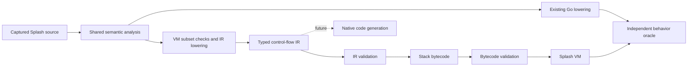

# Splash IR and VM

Approved execution architecture with a deliberately small first implementation. Splash owns its executable semantics through a typed IR and VM, with native machine code as a later target. The compiler and initial VM are implemented in Go. A distributed compiler can run supported VM programs without invoking an external Go toolchain. Self-hosting is a separate project.

The earlier roadmap scoped out a custom runtime in favor of Go. The [execution architecture decision](../decisions/2026-11-26-own-execution-semantics.md) supersedes that constraint. Go transpilation remains the transitional execution target for existing commands and differential tests. Changing the default requires its own release decision. The [semantic compiler interface](semantic-compiler-interface.md) governs shared analysis and verification.

## Backend choices

| Approach | Relevance to Splash |
| --- | --- |
| Go transpilation | Existing bootstrap and comparison target. It supplies a mature toolchain and runtime. Splash lowering must translate any language semantics that differ from Go. |
| LLVM | Mature optimization and native code generation. Integrating its IR and runtime conventions would be substantial work before Splash has defined its execution model. [LLVM language reference](https://llvm.org/docs/LangRef.html) |
| Cranelift | Useful reference for an embeddable backend designed around fast code generation. Consider it when measuring native backend tradeoffs. [Cranelift](https://cranelift.dev/) |
| WebAssembly | Useful reference for typed validation, explicit imports and portable modules. Targeting it would require mapping Splash's runtime contracts onto a second execution model. [Validation](https://webassembly.github.io/spec/core/valid/index.html) · [Modules and imports](https://webassembly.github.io/spec/core/syntax/modules.html) |
| Lua | Useful reference for shipping a VM as an embeddable library and standalone program. Lua's register VM and dynamic value model serve different language semantics. [Lua reference manual](https://www.lua.org/manual/5.4/manual.html#1) |
| Splash VM, then native code | Choose this direction to own errors, resource accounting and host calls. Start with a stack machine and pay the costs of garbage collection, concurrency, native ABIs and deployment only as the language needs them. |

## Compiler migration



At the reviewed #9 revision, the analyzed program already retains captured bytes, module-owned type results, named declaration references, and the call graph. Go emission consumes a flattened AST plus target-specific options. The existing `Backend.Emit` interface returns Go source. The CLI adapts the package name, writes a synthetic module and invokes `go build` itself. That source-emission interface is too narrow for a VM or an artifact that carries verification evidence. [Analyzed program](https://github.com/gosplash/splash/blob/f09ebd9b82961a8323afd2616831e2f2d23e3f07/cmd/splash/main.go#L98) · [Go backend interface](https://github.com/gosplash/splash/blob/f09ebd9b82961a8323afd2616831e2f2d23e3f07/internal/codegen/codegen.go#L18) · [Go build path](https://github.com/gosplash/splash/blob/f09ebd9b82961a8323afd2616831e2f2d23e3f07/cmd/splash/main.go#L242)

Add a parallel lowering path from the same captured analyzed program. Read module-owned typed declarations and call references directly, including alias-qualified calls. Keep Go-specific flattening and approval return-tuple rewriting on the Go path. A backend consumes the compiler's binding decisions and does not re-resolve calls from source names. Use deterministic program-local ordinals for function, record, field and slot operands. These can change between compilations. Cross-revision declaration identity belongs to the compiler and must remain distinct from ordinals and display names.

Compiler completeness is still a dependency for a policy-bearing target. Closures and match have incomplete traversal. The special `ai.prompt` path needs explicit external or unresolved evidence. The initial VM can reject these source forms while that work continues. The frontend also needs more type conformance before its current success alone can admit a program to a typed IR. The new lowerer must require established types and structural support for every accepted form, including the entry and captured dependencies. [Semantic compiler interface](semantic-compiler-interface.md#verified-artifact-production) · [Named-call implementation](https://github.com/gosplash/splash/pull/9)

## Typed control-flow IR

Keep semantic IR distinct from execution bytecode. IR functions have typed inputs and results, local slots, and basic blocks with explicit terminators. VM-002 uses block-local temporaries and local slots for values that cross blocks. Its IR validator checks control-flow targets, value definitions and uses, initialized locals, call signatures, and terminators before backend lowering. The bytecode backend lowers those validated operations into stack instructions. Native lowering can consume the same semantic operations later. Defer SSA, optimization passes, and a general memory model.

The IR should be able to attach declaration identity, source range, and relevant verified policy evidence to operations. Keep calls, record construction and projection, branches, returns, and failure explicit. When the supported subset grows, add typed allocation, error edges, host operations and approval requests. Keep the security-relevant operation and its trust requirements explicit through lowering. Generated code and bytecode must preserve the evaluation and error behavior the compiler verified.

This sketch illustrates future record and host operations. The instruction names are illustrative.

```text
func billing.calculate_total(quantity: i64, price: i64) -> i64
entry:
  total = mul.checked.i64 quantity, price
  return total

func billing.issue_refund(request: RefundRequest) -> Refund
entry:
  approval = approval.request ledger.refund, request
  branch approval, approved, denied
approved:
  refund = host.call ledger.refund, request, approval
  return refund
denied:
  raise ApprovalDenied
```

Start with `String` and `Void` for the hello milestone. Add signed integer and boolean operations, typed calls and branches for recursion. Add immutable record construction and field projection for invoice. Evaluate arguments and field initializers once in source order. Require condition and operand types to be established. Keep mutation, general memory and optionals outside the first fixture set.

The [accepted integer contract](../decisions/2026-11-27-checked-integer-semantics.md) defines `Int` as signed 64-bit, with checked arithmetic, no implicit numeric conversions, and left-to-right evaluation. Division truncates toward zero. Division and remainder by zero report an arithmetic error. Dividing the minimum integer by minus one or negating it reports overflow. Its remainder by minus one is zero. Go remains a differential comparison within its documented parity domain, where applicable integer intermediates fit both backends and evaluation succeeds. All invoice inputs fit signed 32-bit intermediates, including the rounding offset. The VM contract and independent expected results govern boundary tests.

## Stack VM and artifacts

Represent executable code as private in-memory stack instructions. Validate bytecode independently of the IR before creating a runtime. Check instruction operands, branch destinations, stack types and heights at joins, initialized local reads, and call and return signatures. Resolve recursive signatures from the function table before checking function bodies. The dependency direction is frontend analysis to IR lowering, IR to bytecode lowering, and validated bytecode to execution. Execution packages depend on runtime types and source provenance without importing the AST, parser, or type checker.

Retain stack and local-initialization states at reachable basic-block entries. Simulate instructions in order within each block and revisit entries when a predecessor weakens an initialization fact. IR and bytecode validation check string constants for UTF-8. `Invoke` checks incoming string arguments before dispatch. Future artifact loaders and host adapters must enforce the same string invariant at their input boundaries.

Each invocation starts a monotonic dispatch counter at zero shared across all frames. Charge each dispatched opcode, including a call that hits the frame limit or arithmetic that reports an error. If the instruction budget is exhausted, report that before dispatching the next opcode. Count the entry invocation as the first frame. Each frame has its own locals and operand stack. Calls take their declared arguments from the caller and returns transfer only the declared result. Distinguish admission failure, invalid IR, invalid bytecode, arithmetic errors, and limit exhaustion. Preserve source locations and include dispatch count and frame depth for runtime failures. Use malformed fixtures as seeds when extending validator fuzz coverage.

A later versioned `.spb` container can persist the validated program. Stage this after in-memory conformance. Keep canonical runtime types, constants, function signatures and code, explicit typed host imports, declared and derived authority where verified, debug locations, and provenance in bounded sections. Specify version/feature compatibility, deterministic encoding and separate debug data from runtime decisions. Validate the actual types, instructions and imports on load. An embedded authority manifest can describe requirements. It cannot establish that the loader should grant them. Policy-bearing distribution needs authenticated compiler evidence or trusted reanalysis bound to the exact artifact. Add malformed format, incompatible version and import mismatch cases before shipping a loader.

Run VM-002 conformance through an internal runtime interface. `RunMain` invokes the declared entry point. `Invoke(functionID, arguments)` checks the supplied arguments against the selected function signature and starts a fresh invocation under the configured limits. The function ID is local to the compiled program. Source lowering still requires a parameterless Void main in VM-002. The runtime can invoke another function from that program. A published export contract, library-only source admission, ABI and embedding surface remain future work. After the internal path works, consider an opt-in CLI form such as `splash run main.splash --backend vm`. Preserve `splash check` as a source-analysis command. `splash test` and `splash trace` can follow deterministic adapters. `splash build main.splash --target vm` can follow a supported bytecode format. Native targets such as `arm64-macos` and `x86_64-linux` are later product decisions. They require an ABI, runtime and artifact-format strategy and independent target conformance.

## Admission, authority and runtime evidence

VM-001 admitted one parameterless `main` and resolved builtin `println` calls on string literals. VM-002 extends admission to top-level named functions in one unannotated, import-free module, with `Int`, `Bool`, and `String` values and `Void` results. The supported forms are literals, local bindings, `if` and `else`, returns, resolved named calls, builtin `println`, integer arithmetic and ordering, integer and boolean equality, and boolean negation. A statement following a termination in the same block is outside this subset. The application entry has no parameters and can omit its result annotation or spell it `Void`. Use the implicit result spelling `fn main()` for Go differential tests because the Go backend fails to generate the required return when `main` has an explicit `Void` result. Loops, records, and module imports remain outside the subset. The internal entry point runs the existing source checks and validates admitted source forms explicitly before lowering. Reject unknown semantic facts, unresolved calls, unsupported syntax, and policy-bearing annotations or operations. A rejected VM input yields a diagnostic without silently changing targets.

VM-003 admits captured user modules, aliases, declared exports, and resolved calls across modules. It adds immutable nominal records with `Int`, `Bool`, or `String` fields, explicit construction, and field projection. Each resolved type declaration receives its own program-local record ID. Initializers run once in source order before packing fields in declaration order. The runtime keeps fields private and accepts a record argument only from the same runtime with the expected record ID. The record table describes field types by slot and defines no native memory layout or cross-runtime ABI. Record fields require explicit initializers and support neither defaults nor annotations. Nested records, mutation, record equality, host adapter imports, and public embedding remain outside VM-003. The Go backend still flattens record names, so same-named record declarations across modules have VM-only conformance coverage. The public CLI continues to use Go for builds.

For a later capability-aware runtime, an artifact-specific `VerifiedProgram` establishes what a program may request under the compiler's rules. It does not grant concrete host access. Instantiate each run with a host table containing only explicitly granted adapters, matched to verified imports and operation contracts. Resource identifiers, destination rules, credentials and request-specific approval belong to trusted adapter configuration. Avoid ambient filesystem, network, process or provider access.

| Runtime concern | Design requirement for the later policy-bearing runtime |
| --- | --- |
| Resource accounting | Meter instructions and frames deterministically. Account for language allocations separately from the host process's actual memory. Enforce deadlines at dispatch and propagate cancellation into host operations. Use OS isolation for untrusted candidates. |
| Host authority | Check operation grants and resource restrictions at invocation. Require the adapter to enforce destination and resource scope in its own external calls. |
| Approval | Bind the approval to the exact operation, normalized request, principal and invocation context. Define expiry, replay and denial behavior. The host operation validates the approval before performing the mutation. |
| External costs | Propagate explicit limits to the provider where supported. Charge from trusted usage evidence and specify how estimated, unknown and exceeded costs affect the call. |
| Observability | Capture deterministic sequence numbers and source-correlated call, branch, outcome and authority events. Keep classified values and credentials out of traces by default. Treat richer value tracing as separately authorized debugging. |

The runtime and bound adapters remain trusted. Source verification establishes modeled language and policy properties. Independent IR and bytecode validation establishes structural properties at each representation. Runtime grants and controls establish what this invocation can access and spend. TTCS candidates still require the protected grader and process isolation. [Verification completeness](semantic-compiler-interface.md#commands-and-status) · [TTCS isolation design](ttcs-harness.md#isolation-and-run-lifecycle)

Make deterministic execution under deterministic host inputs a design objective. Use a virtual clock, seeded randomness, in-memory state, scripted HTTP and AI responses, and request-bound test approval. A controlled scheduler can follow defined concurrency semantics. Capture reproducible execution events and consider replay when the host contracts define what must be recorded. Runtime evidence should link back to static contracts for repair without exposing classified payloads or secrets.

## Cross-platform execution and contracts

Treat portable business logic and data contracts as IR requirements. Preserve fixed-width values, explicit typed record layouts and structured errors. Keep backend storage layouts separate from any published ABI or wire layout. Export identity, value ownership and lifetimes, cancellation and async behavior, and compatibility checks need explicit contracts before a target exposes them.

| Capability | Purpose and boundary |
| --- | --- |
| Local embedding and bindings | Execute the same Splash implementation through host-language interfaces. An embedded VM can come first for Swift and Kotlin. Ahead-of-time native libraries and a WebAssembly web target can follow shared conformance. |
| Remote SDK generation | Derive typed requests, responses, serialization, validation and error contracts for a remote Splash service. Clients have no local implementation or server authority by virtue of the SDK. |
| Source transpilation | Consider readable Swift, Kotlin or TypeScript for a supported portable subset. Preserve evaluation and error semantics through independent conformance before expanding the subset. |

Target deployment policies describe which effects a deployment admits. Export admission must check transitive authority against that policy once compiler evidence supports the check. Runtime host grants still define the concrete operations for a particular execution. Client-side validation can give fast feedback. The server independently validates inputs and authorizes operations. VM-001 introduces no export syntax, binding generator, SDK, source target or target policy enforcement.

## Acceptance and rollout

| Milestone | Implementation | Independent evidence |
| --- | --- | --- |
| VM-001 · Hello world | Lower a tiny source program through one typed IR block and a handful of stack instructions. | The same source prints `Hello, world` in Go and the VM. The validator rejects a wrong stack shape and the backend rejects an unsupported source form before dispatch. |
| VM-002 · Recursion | Add checked arithmetic, branches, typed call frames, and internal named invocation. | Compare recursive base and recursive cases to independent expected values and to Go within its parity domain. Test arithmetic failures, argument validation, frame isolation, and deterministic dispatch and frame exhaustion. |
| VM-003 · Invoice | Add qualified imports, records, and field projection for the existing probe. | The exact same Splash driver and source passes all nine cases through Go and VM. Both execute the truncating starter and fail on the half-cent case. The Go-language comparator stays independently graded. [Invoice fixture](https://github.com/gosplash/splash/pull/10) |
| Proposed VM-004 · Public execution and embedding | Start with opt-in `splash run invoice.splash --backend vm`, then define library invocation contracts on top of the internal runtime. | A standalone compiler binary runs the invoice oracle without a Go toolchain. Measure CLI startup through execution against Go transpilation. An embedding host can invoke an exported function with validated arguments and observable errors once its interface is defined. |
| Proposed VM-005 · Portable artifacts and bindings | Define a versioned artifact and consider generated Swift and Kotlin interfaces. | Reuse an independent business-logic fixture across the portable artifact and supported language bindings. |

Keep the hello fixture small enough to isolate entry, constant, output and return. VM-003 runs the invoice oracle from the Go test suite through the internal VM path. Add a VM lane to the standalone grader once the public command is available. Differential results help find backend drift. Independent expected behavior and the specified semantics decide correctness when backends disagree.

Grow the shared conformance suite from independently expected `SPEC.md` results. Cover precedence and associativity, type compatibility, evaluation order and short-circuiting, arithmetic bounds, function and record semantics, error propagation, Unicode, and modeled authority. Select cases by target support and run the same oracles for each admitted case.

The Go reference path at `f09ebd9` passed native smoke checks for literal hello and factorial. It printed `Hello, world`, then `1` and `120` for factorial inputs 0 and 5. The run used Go 1.26.3 on darwin/arm64. These are Go-side baselines for the first two milestones.

Record native Go from Go source, Splash through Go transpilation, and the same Splash source through Splash VM as separate conditions. Compare the two Splash paths on identical inputs to examine backend effects without changing the authoring language. Measure frontend analysis, lowering, validation, external build where applicable, startup, execution, memory and total edit-to-test latency separately. Keep these measurements distinct from TTCS, which measures end-to-end production of independently accepted solutions.

After the fixture milestones, expand the executable subset with optionals, typed errors and an explicit allocation model. Then introduce host capabilities, deterministic adapters and execution tracing. Run the conventional inventory demonstration before the policy-bearing support demonstration. The latter requires effect and call coverage, native approval and denial behavior, trustworthy artifact admission, and audited host integrations. Measure analysis, IR lowering, validation, cold startup, execution, and repair loops separately before claiming a performance or AX improvement.

Treat changing the default away from Go as a release decision. Require supported-application parity, documented behavior on boundary inputs, debugger and error-reporting readiness, packaging and migration instructions. Once execution semantics and the runtime ABI stabilize, evaluate the first native target. A Splash compiler written in Splash comes later, after the language can express and maintain the toolchain and an independent bootstrap can verify it.
